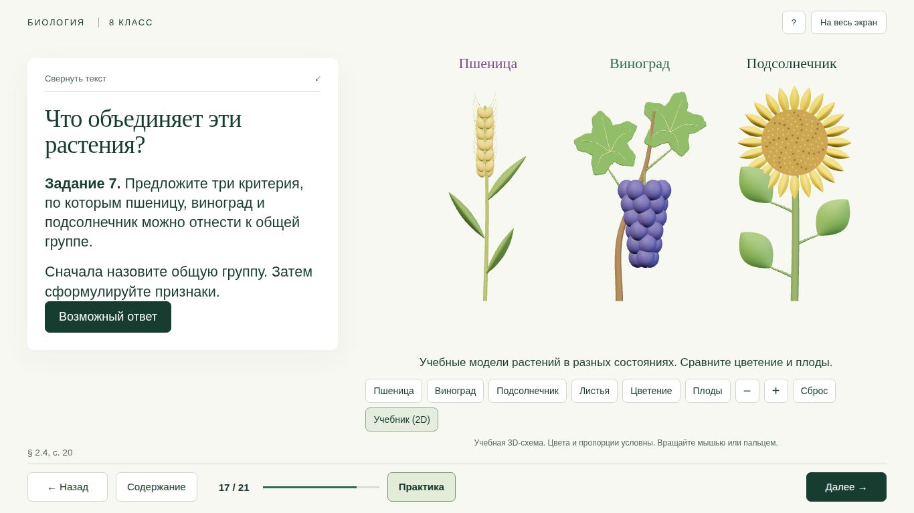
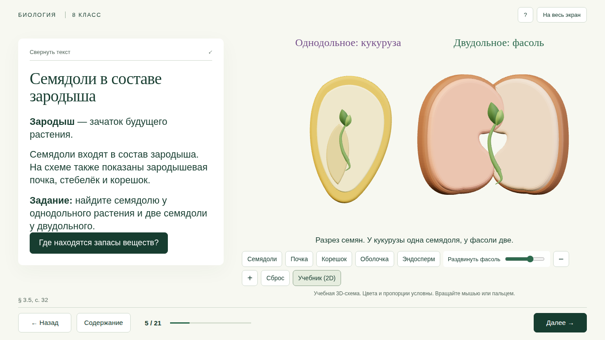
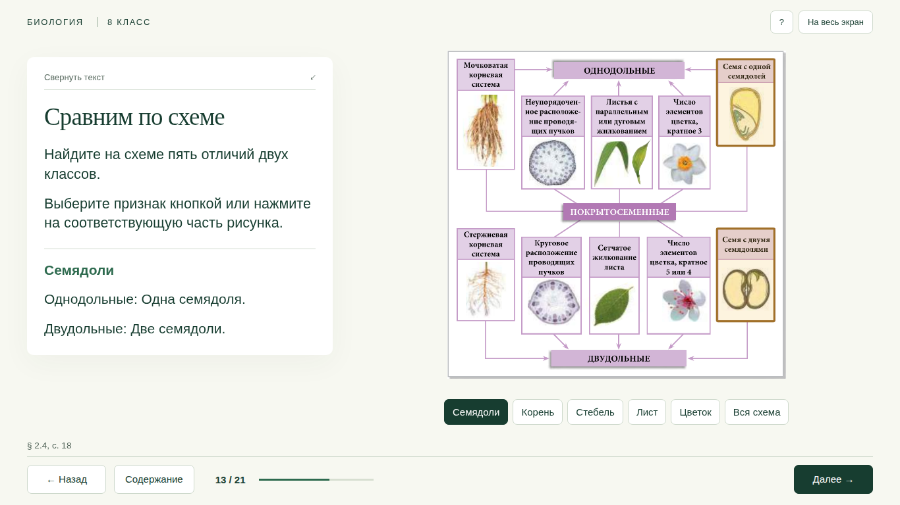
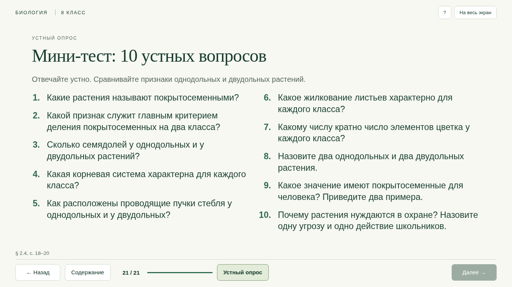

<div align="center">

# 🌿 Покрытосеменные растения

### Однодольные и двудольные · Биология, 8 класс

Полный урок с вращаемыми 3D-моделями, заданиями и устным тестом.

[](https://xondell.github.io/biology-8-angiosperms-3d/)
[](#содержание-урока)
[](#содержание-урока)

[**Начать урок →**](https://xondell.github.io/biology-8-angiosperms-3d/) · [Автономный HTML](index.html) · [Управление](#управление) · [Исходники](#редактирование)



</div>

## Что внутри

- **Каждый из 21 слайда интерактивный.** Выбор признаков, задания с обратной связью, сравнение растений, выделение признаков на схеме и устный опрос.
- **3D на восьми слайдах.** Семена, корни, стебли, жилкование, строение листа, цветки и модели пшеницы, винограда и подсолнечника.
- **Работа с частями модели.** Вращение, приближение, подсветка структур, раздвижение семядолей фасоли и просмотр пучков внутри стебля.
- **Опорная схема с выделением пяти признаков.** Рисунок постоянно виден. Кнопки и области на схеме выделяют соответствующие признаки обоих классов.
- **10 устных вопросов на последнем слайде.** Выбор вопроса, случайный вопрос и отметка отвеченных.
- **Все материалы в одном HTML.** Для просмотра скачанного файла не нужны установка, аккаунт или интернет.

<details>
<summary><strong>Посмотреть семена в 3D</strong></summary>
<br>



</details>

<details>
<summary><strong>Сравнение по опорной схеме</strong></summary>
<br>



</details>

<details>
<summary><strong>Посмотреть устный тест</strong></summary>
<br>



</details>

## Запуск

### Онлайн

Откройте **[презентацию на GitHub Pages](https://xondell.github.io/biology-8-angiosperms-3d/)** и нажмите **«На весь экран»**. Можно сразу открыть [семена](https://xondell.github.io/biology-8-angiosperms-3d/#5), [жилкование](https://xondell.github.io/biology-8-angiosperms-3d/#8), [три растения](https://xondell.github.io/biology-8-angiosperms-3d/#17) или [устный тест](https://xondell.github.io/biology-8-angiosperms-3d/#21).

### Без интернета

1. Откройте файл [`index.html`](index.html) в репозитории и скачайте его кнопкой **Download raw file**. Также можно скачать репозиторий через **Code → Download ZIP**.
2. Откройте сохранённый `index.html` в современном браузере.
3. Для 3D требуется WebGL 2. Если он недоступен, презентация показывает исходные рисунки учебника.

Иллюстрации, модели и код отображения встроены в HTML. Установка Node.js нужна только для изменения и пересборки исходников.

## Управление

| Действие | Управление |
| --- | --- |
| Следующий / предыдущий слайд | `→` / `←`, кнопки внизу |
| Следующий слайд | `Пробел` |
| Первый / последний слайд | `Home` / `End` |
| Полноэкранный режим | `F` или кнопка вверху |
| Свернуть / вернуть текст | `T` на визуальных слайдах |
| Выбрать часть 3D-модели | Кнопка с названием или нажатие на модель |
| Повернуть модель | Перетаскивание мышью или пальцем |
| Приблизить модель | Колёсико мыши, `+` / `−` в управлении моделью |
| Вернуть исходный вид | **Сброс** |
| Показать рисунок из учебника | **Учебник (2D)** |
| Открыть задание | **Практика** на соответствующих слайдах |

На опорной схеме выберите **«Семядоли»**, **«Корень»**, **«Стебель»**, **«Лист»** или **«Цветок»**. Подсветятся две соответствующие области, а **«Вся схема»** уберёт выделение. Области рисунка доступны мышью и с клавиатуры.

На телефоне текстовые панели прокручиваются, а длинную строку кнопок 3D можно листать по горизонтали. Ответы и отметки сохраняются при переходе между слайдами до перезагрузки страницы.

## Содержание урока

| Слайды | Материал |
| --- | --- |
| 1–3 | Тема, определение и разнообразие покрытосеменных |
| 4–9 | Семядоли, строение семени, корни, стебель, жилкование и цветок |
| 10–11 | Признаки и представители двух классов |
| 12–17 | Сравнительная таблица, постоянная опорная схема, строение листа и практические задания |
| 18–20 | Значение растений, охрана и выводы |
| 21 | Мини-тест из 10 устных вопросов |

Сравнение строится на пяти критериях из учебника: **число семядолей, корневая система, расположение проводящих пучков, жилкование и число элементов цветка**.

## Учебная основа

**Нина Бырназ. «Биология. Учебник для 8-го класса».** Кишинёв: Prut Internațional, 2024. Русское издание. ISBN 978-9975-54-831-1.

Основная тема — **§ 2.4, с. 18–20**. Дополнительная схема семени — **§ 3.5, с. 32**. Для пояснений используются § 2.1, с. 10–11, и § 3.4, с. 30–31. Краткие ссылки на страницы приведены внизу слайдов, подробные сведения доступны в справке «?».

3D-модели — учебные схемы. Их цвета, пропорции и число мелких элементов условны. Исходные иллюстрации учебника доступны в режиме 2D. В задании 4 текст называет ландыш, а рисунок подписан «Подснежник»; в презентации сравниваются изображённые подснежник и лопух.

Сведения о правообладателях иллюстраций и лицензия Three.js находятся в [`THIRD_PARTY_NOTICES.md`](THIRD_PARTY_NOTICES.md). Полный PDF учебника в репозиторий не включён.

## Редактирование

Используются HTML, CSS, JavaScript, **Three.js 0.186.1** и **esbuild 0.28.2**. Готовый сайт — статический `index.html` в корне репозитория.

```bash
npm ci
npm run build
```

Для локального просмотра:

```bash
npm run preview
```

Откройте `http://127.0.0.1:8080`. Для просмотра готового файла можно просто открыть `index.html` без запуска сервера.

| Файл | Что менять |
| --- | --- |
| `src/presentation.mjs` | Тексты, задания, порядок и содержание слайдов |
| `src/three/models.js` | Геометрия и части 3D-моделей |
| `src/three/main.js` | Отображение, выделение и управление 3D |
| `src/activities.js` | Задания и устный опрос |
| `src/lesson.js` | Навигация, таблица, выделение на схеме и базовые взаимодействия |
| `src/*.css` | Оформление и адаптация под разные экраны |
| `src/assets.json` | Встроенные иллюстрации |
| `scripts/build.mjs` | Сборка автономного HTML |

После правок выполните `npm run build` и сохраните в Git обновлённый `index.html` вместе с исходниками. GitHub Pages публикует его из корня ветки `main`.

---

<div align="center">

**Рассмотреть → сравнить → объяснить → проверить себя**

[Открыть урок](https://xondell.github.io/biology-8-angiosperms-3d/)

</div>
